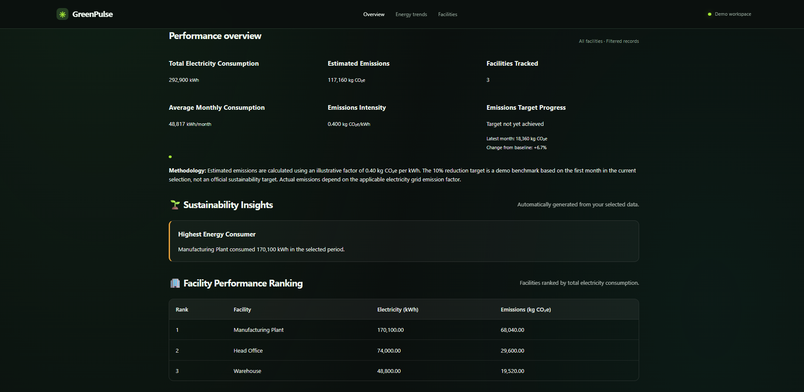
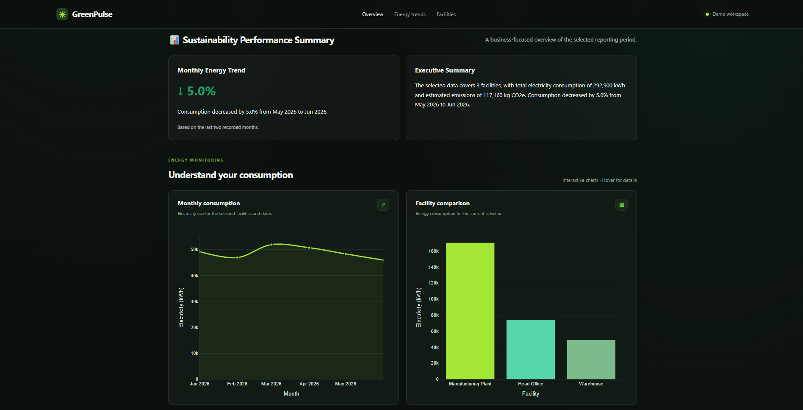
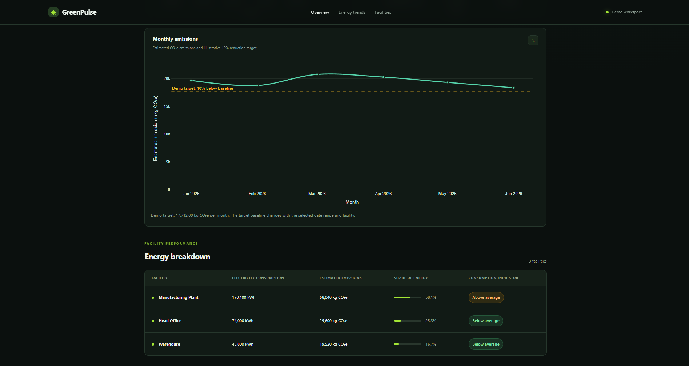
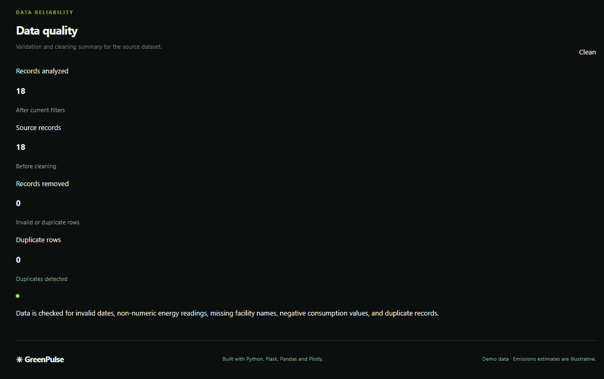

# GreenPulse — Sustainability Analytics Dashboard

                **Turn energy data into actionable sustainability insights.**
## Dashboard Preview


GreenPulse is a local-first sustainability analytics dashboard built with Python and Flask. It helps organizations explore electricity consumption, estimate associated carbon emissions, compare facility performance, and monitor illustrative reduction targets through interactive visualizations.

The project demonstrates how data analytics and business intelligence can support sustainability monitoring aligned with the United Nations Sustainable Development Goals (SDGs).

**Repository:** [vinayak-mishra-610/GreenPulse](https://github.com/vinayak-mishra-610/GreenPulse)
## Dashboard Screenshots

### 1. KPI Overview



### 2. Energy Consumption Analysis



### 3. Emissions Analysis



### 4. Data Quality




## Overview

Organizations need clear visibility into their energy consumption to identify high-consuming facilities, understand trends, and evaluate opportunities for improvement. GreenPulse brings these insights together in an interactive dashboard.

The project currently uses a small demonstration dataset, making it suitable for exploring the analytics workflow without requiring paid cloud services.

## Features

- **Sustainability KPIs** — total electricity consumption, estimated emissions, number of facilities, average monthly consumption, emissions intensity, and emissions target progress.
- **Interactive filtering** — filter by facility and date range, including combined filters.
- **Energy trend analysis** — visualize monthly electricity consumption over time.
- **Emissions monitoring** — explore estimated monthly emissions against an illustrative reduction target.
- **Facility performance comparison** — compare electricity use and estimated emissions across facilities.
- **Automated insights** — surface consumption patterns and changes in monthly energy use.
- **CSV export** — export data for further analysis.
- **Data quality reporting** — review record counts, duplicate detection, and data-cleaning results.
- **Responsive dashboard styling** — a dark interface with interactive charts and sustainability-focused visual elements.

## Technology Stack

| Technology | Purpose |
|---|---|
| Python | Core application and analytics logic |
| Flask | Web application and routing |
| Pandas | Data cleaning, transformation, and aggregation |
| Plotly | Interactive charts and visualizations |
| HTML and CSS | Dashboard structure and styling |
| CSV | Demonstration data storage |
| Git and GitHub | Version control and project presentation |

## Project Structure

```text
GreenPulse/
├── app.py                  # Flask application
├── config.py               # Application configuration
├── requirements.txt        # Python dependencies
├── data/
│   └── energy_data.csv     # Demonstration dataset
├── services/
│   ├── __init__.py
│   └── analytics.py        # Data processing and analytics
├── static/
│   └── style.css           # Dashboard styling
├── templates/
│   └── index.html          # Dashboard template
├── tests/                  # Test-related files, if present
├── .gitignore
└── README.md
```

## Getting Started

### Prerequisites

- Python 3.11 or later, with a compatible version supported by the dependencies
- Git
- Visual Studio Code or another code editor

### 1. Clone the repository

```bash
git clone <https://github.com/vinayak-mishra-610/GreenPulse>
cd GreenPulse
```

Replace the placeholder with your actual GitHub repository URL.

Alternatively, download the repository and open its folder in VS Code.

### 2. Create a virtual environment

On Windows PowerShell:

```powershell
python -m venv .venv
```

### 3. Activate the environment

```powershell
.\.venv\Scripts\Activate.ps1
```

If PowerShell blocks activation, use Command Prompt or configure your local execution policy appropriately.

### 4. Install dependencies

```powershell
python -m pip install -r requirements.txt
```

### 5. Run the application

```powershell
python app.py
```

Open the local address displayed in the terminal, typically:

`http://127.0.0.1:5000`

To stop the development server, press `Ctrl + C` in the terminal.

## Analytics Methodology

### Electricity consumption

Electricity consumption is aggregated across the selected facilities and reporting period. Monthly totals are used to visualize consumption trends and calculate average monthly usage.

### Estimated emissions

GreenPulse estimates emissions using the following illustrative factor:

**0.40 kg CO₂e per kWh**

Estimated emissions are calculated as:

`Estimated emissions = Electricity consumption × Emission factor`

Emissions intensity represents estimated emissions per unit of electricity consumed.

### Illustrative reduction target

The emissions chart uses a demonstration target set at **10% below the first month's estimated emissions** in the current selection.

The dashboard compares the latest visible month's emissions with this target. The target is recalculated when the selected facilities or date range changes.

This is a demonstration benchmark, not an official organizational commitment or regulatory threshold.

### Data quality

The analytics service validates input records, handles invalid dates and energy values, identifies missing facility names, and removes duplicate records before analysis.

## Demonstration Dataset

The current dataset is a small CSV containing monthly electricity readings for three demonstration facilities across January–June 2026.

It is intended to demonstrate data processing, filtering, visualization, and sustainability calculations—not to represent verified real-world organizational energy usage.

## Alignment with the UN Sustainable Development Goals

GreenPulse relates to the following goals:

- **SDG 7 — Affordable and Clean Energy:** supports visibility into energy consumption and opportunities to improve energy efficiency.
- **SDG 12 — Responsible Consumption and Production:** encourages measurement and monitoring of resource use.
- **SDG 13 — Climate Action:** demonstrates how estimated emissions data can be used to explore reduction scenarios.

This project demonstrates analytical capabilities relevant to these goals; it does not independently certify an organization's sustainability performance.

## Limitations

- The current dataset is small and intended for demonstration.
- The emissions factor is illustrative and should not be used for official carbon accounting.
- Real emissions estimates require an appropriate, documented emissions factor for the relevant electricity grid, location, and reporting period.
- The reduction target is a demo benchmark, not a validated science-based target.
- The application currently runs locally and does not require a paid cloud deployment.

## Future Improvements

- Integrate larger, verified energy datasets.
- Support configurable, location-specific emissions factors.
- Add year-over-year and facility-level trend comparisons.
- Introduce user-configurable sustainability targets.
- Expand automated insights and anomaly detection.
- Add automated tests and reporting features.
- Explore deployment options when appropriate.

## Author

**Vinayak Mishra**

B.Tech — Computer Science and Engineering (Data Science)

Interested in data analytics, business intelligence, Python, and sustainability-focused technology.

---

*GreenPulse is an educational and portfolio project built to demonstrate data analytics, interactive dashboard development, and sustainability reporting concepts.*